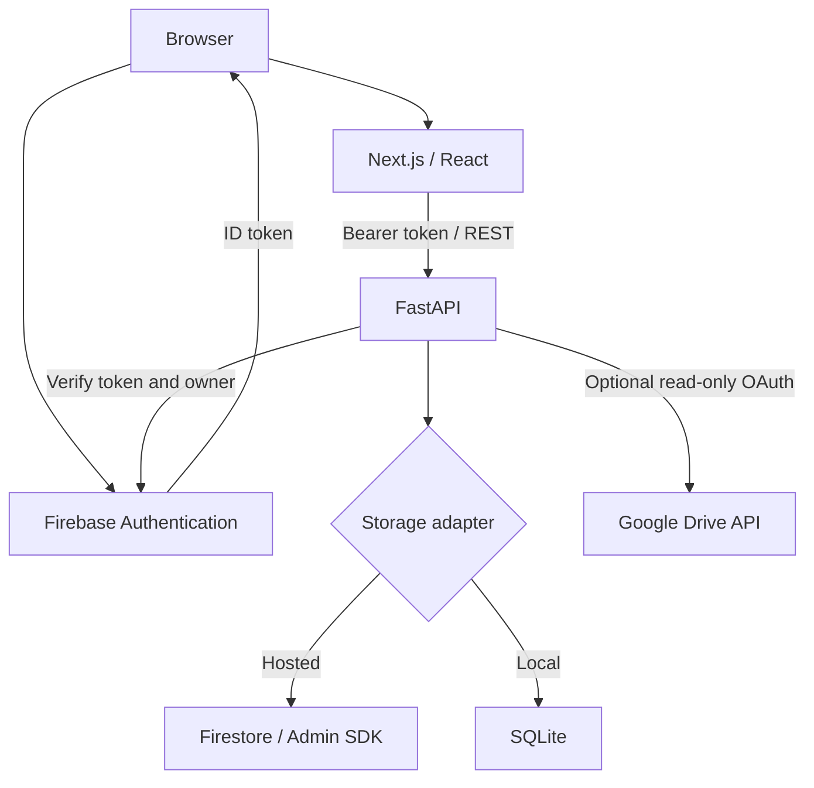

# Study Hub

An integrated academic productivity workspace for coursework, weekly study planning, exam preparation, tasks, focus sessions and learning resources.

    [](LICENSE)

[CI workflow](.github/workflows/ci.yml) · [Architecture](docs/architecture.md) · [Getting started](#getting-started) · [Changelog](CHANGELOG.md)

Built to support a university study routine, originally for coursework at DTU. This is an independent project, not an official university service. The hosted application currently supports a private, owner-authorized workspace, not public student registration.

## Workspace

<!-- Add authentic, sanitized screenshots only after the capture and rights review in docs/screenshots/README.md. -->

| Area | What it does |
| --- | --- |
| Home | Daily priorities, course progress, deadlines, upcoming exams and study statistics. |
| Study | Semesters, courses, teaching weeks, activities, bulk generation, course resources and archive/restore. |
| Tasks & Calendar | Shared completion state, scheduling, priorities, recurrence and derived exam events. |
| Exam Prep | Separate revision progress, exam papers, one new paired solution per paper, attempts and practice Focus timers. |
| Focus | Countdown or stopwatch, pause/resume, persistent sessions and study-time summaries. |
| Resources | External links and optional read-only Google Drive discovery, PDF preview and reading positions. |

The [screenshot capture plan](docs/screenshots/README.md) defines a fictional demonstration workspace. No mock or private screenshots are presented as real application captures.

## Architecture



The two Vercel services share one origin. Local development uses SQLite and loopback-only authentication without cloud credentials. In hosted mode the API verifies Firebase tokens and restricts access to the configured owner; browser-side Firestore access is denied by the provided rules.

**Stack:** Next.js 16, React 19, TypeScript, Python, FastAPI, Pydantic, Firebase Authentication/Firestore, SQLite, Google Drive API, Vercel and GitHub Actions. See [architecture](docs/architecture.md) for actual module boundaries and storage contracts.

## Getting started

Use Node.js 24 LTS (latest patched 24.x) and Python 3.12 to match CI. The root `.nvmrc` selects the Node major for compatible version managers; on Windows install/select Node 24 using your existing version manager or the official installer. Verify `node --version` and `py -3.12 --version` before creating the virtual environment. The frontend lockfile is committed; backend requirements use version ranges. No Firebase or Drive account is necessary for the basic local workspace.

Clone the repository (access is required while private), then from its root open two PowerShell terminals.

**Terminal 1 — API**

```powershell
Set-Location backend
py -3.12 -m venv .venv
.\.venv\Scripts\python.exe -m pip install -r requirements.txt
$env:STUDY_HUB_AUTH_MODE = 'local'
$env:STORAGE_BACKEND = 'sqlite'
$env:SQLITE_PATH = './data/studyhub.sqlite3'
.\.venv\Scripts\python.exe -m uvicorn app.main:app --host 127.0.0.1 --port 8000 --reload
```

**Terminal 2 — Web**

```powershell
Set-Location web
npm.cmd ci
if (-not (Test-Path .env.local)) { Copy-Item .env.local.example .env.local }
npm.cmd run dev
```

Open http://127.0.0.1:3000. API health: http://127.0.0.1:8000/health. The local database is ignored by Git. Do not bind the local-auth API to a public interface.

The backend example lists configuration keys; Python does not automatically load it. Set environment variables in the process or use a deliberately configured env-file loader. For hosted configuration and optional Drive OAuth, follow the [deployment guide](docs/deploy-vercel-firebase.md).

## Engineering highlights

- Transactional Focus lifecycle and recurring-task creation prevent duplicate active sessions and successors.
- Shared workspace records and targeted response reconciliation keep views consistent without a full snapshot after ordinary edits.
- PDF reopens revalidate Firebase and Drive permissions before reusing tab-local bytes. In a historical controlled local experiment, median reopen latency fell from 1,079 ms to 93 ms (~91.4%); response body fell from 8.47 MB to zero on a validated reopen. Five trials per build, synthetic PDF, mocked API, viewer-frame mount rather than first visible page. Not a production benchmark; see [performance evidence](docs/performance.md).
- Isolated hosted environments, staged credential checks, history scanning, dependency audits and regression tests support release safety.

## Development checks

From the repository root (use the virtual environment created above):

```powershell
Push-Location backend
$env:STUDY_HUB_AUTH_MODE = 'local'
$env:STORAGE_BACKEND = 'sqlite'
.\.venv\Scripts\python.exe -m pytest -q
.\.venv\Scripts\python.exe -m compileall -q app
Pop-Location
python scripts/check_credentials.py
Push-Location web
npm.cmd ci --no-audit --no-fund
npm.cmd test
npm.cmd run lint
$env:NEXT_PUBLIC_STUDY_HUB_AUTH_MODE = 'local'
$env:NEXT_PUBLIC_API_URL = '/'
npm.cmd run build
Pop-Location
```

`npm run lint` is a strict TypeScript check, not ESLint. See [testing and release gates](docs/testing.md) for dependency audits, Gitleaks and manual browser validation. CI and manual checks must pass on the exact proposed release commit.

## Documentation

| Document | Purpose |
| --- | --- |
| [Architecture](docs/architecture.md) | System design, data model, security and trade-offs |
| [Deployment](docs/deploy-vercel-firebase.md) | Local, Preview and Production configuration |
| [Testing](docs/testing.md) | Reproducible checks and release acceptance |
| [Performance](docs/performance.md) | Historical evidence and benchmarking methodology |
| [Asset credits](docs/asset-credits.md) | Image provenance and redistribution review |
| [Contributing](CONTRIBUTING.md) | Branches, pull requests and releases |
| [Security](SECURITY.md) | Private reporting and security boundaries |
| [Changelog](CHANGELOG.md) | Consolidated release history |

## Current limitations

Owner-only hosted access; manual Drive scans; no direct local-file upload endpoint, offline synchronization or DTU Learn API integration. PDF preview uses a native browser viewer; links and rendering can vary by browser. SQLite data is not automatically imported into Firestore. Browser E2E automation, containerized development and distributed observability remain planned, not implemented.

## License

Source code is offered under the [MIT License](LICENSE). Third-party dependencies retain their own licenses. Existing image assets are subject to the [asset provenance review](docs/asset-credits.md); do not assume unresolved assets are cleared for public redistribution.
