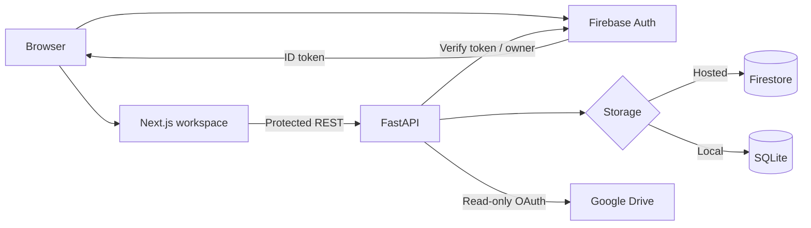
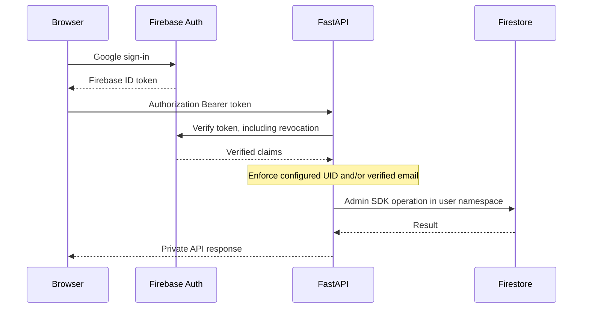
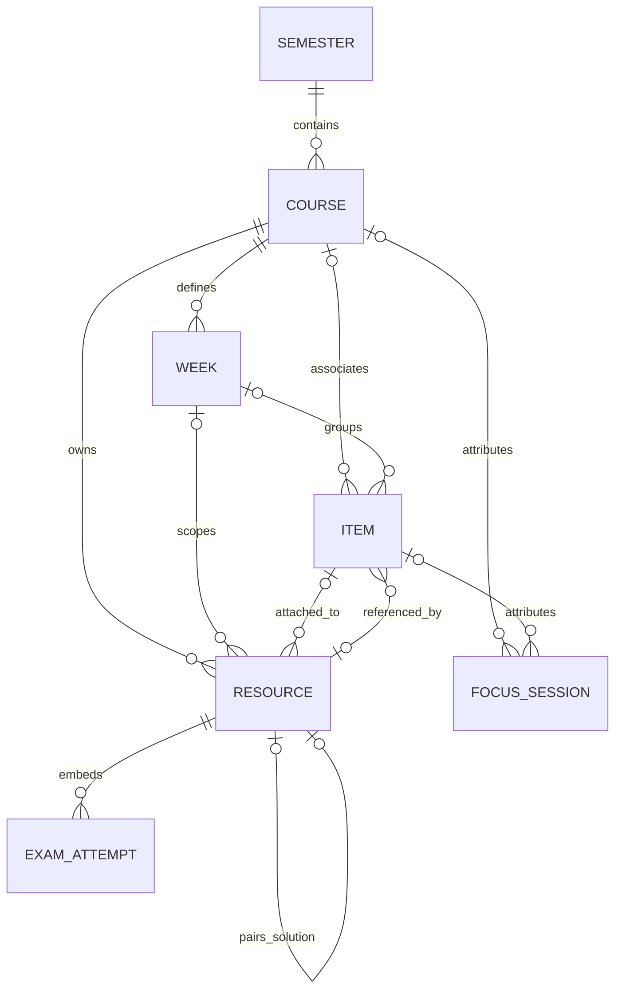
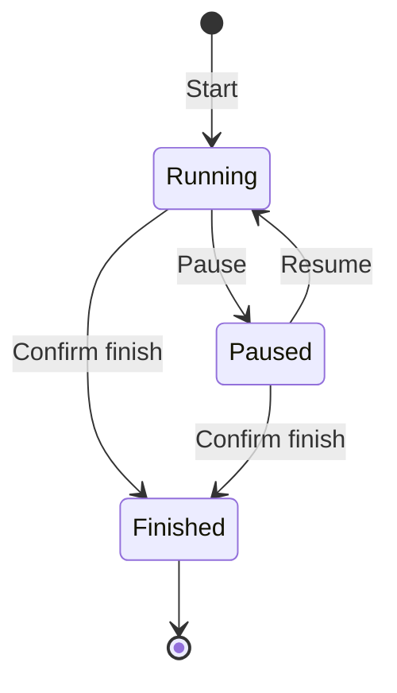
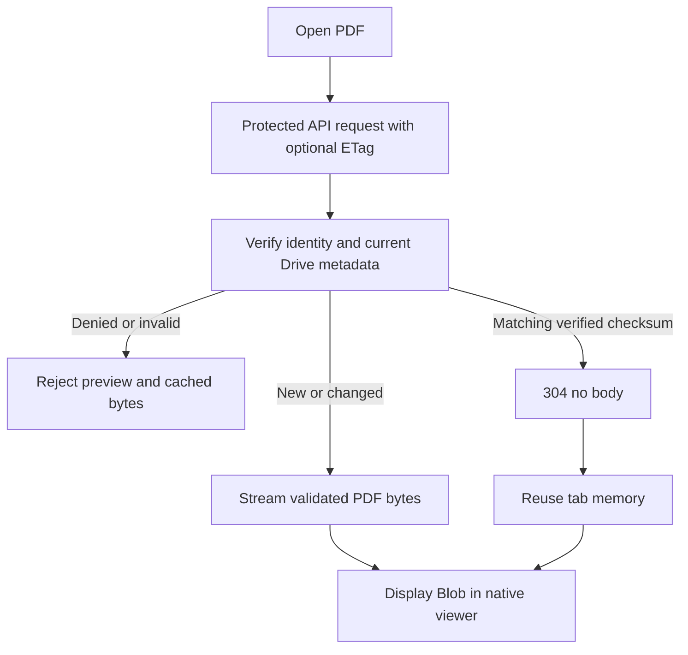

# Architecture

[Home](../README.md) · [Deployment](deploy-vercel-firebase.md) · [Testing](testing.md) · [Performance](performance.md)

## Scope and boundaries

Study Hub is a private academic workspace. The Next.js app and FastAPI service are separately built but routed through one Vercel origin (`/api/*` and `/health` to API; other paths to web). The local API listens on loopback and uses SQLite. Hosted mode requires Firebase Authentication and Firestore; Drive is optional and independent of sign-in. No public registration, shared multi-user collaboration or DTU Learn API client exists.

## Code map

| Path | Responsibility |
| --- | --- |
| `web/app/page.tsx`, `globals.css` | Workspace shell, navigation, shared state, dialogs and styling |
| `web/components/course-planner.tsx`, `tasks-planner.tsx`, `exam-prep.tsx` | Domain-specific user interface |
| `web/components/pdf-workspace.tsx`, `pdf-opening-overlay.tsx` | PDF reader, loading and feedback |
| `web/lib/api.ts`, `auth.ts`, `types.ts` | API client, Firebase mode and client contracts |
| `web/lib/snapshot-cache.ts`, `snapshot-loading.ts` | Shared snapshot reconciliation and loading |
| `web/lib/focus-timing.ts`, `clock.ts`, `focus-display.ts` | Timer calculations and presentation |
| `web/lib/activity-generator.ts`, `exam-prep.ts`, `study-progress.ts` | Activity, exam and progress rules |
| `backend/app/main.py` | API, snapshot, course/week creation, items, resources, Focus |
| `backend/app/workspace.py`, `workspace_models.py` | Structural editing, archive, safe deletion, pairing |
| `backend/app/models.py` | Pydantic record contracts and validation |
| `backend/app/storage.py` | SQLite and Firestore persistence, transactional guards |
| `backend/app/security.py`, `deployment.py` | Auth and fail-closed deployment configuration |
| `backend/app/drive.py`, `matching.py` | Drive OAuth, scanning, suggestions and validated PDF streaming |
| `backend/app/recurrence.py` | Stable recurring successor dates and IDs |
| `vercel.json`, `backend/server.py` | Hosted routing and ASGI entry point |

### Runtime and dependency baseline

CI uses Node.js 22 and Python 3.12. `web/package.json` declares minimum Node 20.9; follow CI rather than assuming any newer version is supported. Next.js is pinned to 16.4.6; the frontend lockfile is authoritative for exact React, Firebase and transitive versions. The gRPC override is 1.14.7. Python requirements specify ranges (FastAPI >=0.115,<1; Pydantic >=2.8,<3; Firebase Admin >=6.5,<8; cryptography >=50.0.2,<51). Installed Python versions depend on resolution. Package and API metadata currently say 0.5.0 even though historical notes describe v0.6 features; do not infer release tags from metadata.

## Identity and security

`current_user` accepts local mode only from loopback/test clients; hosted mode refuses local auth. Missing/invalid tokens produce 401, disallowed identities 403, invalid server auth configuration 503. If both owner restrictions are set, both must match. Revocation checks run in a worker thread rather than weakening verification. Client Firestore reads and writes are denied by the rules template; Admin SDK bypasses client rules and must use restricted IAM. Preview and Production must declare distinct expected project IDs and matching Admin and web project IDs; startup refuses mismatch. This is owner restriction, not a general multi-tenant product. API responses use private/no-store and timing headers. Next.js sets frame, referrer, MIME and permissions headers; there is no claim of a comprehensive CSP.

## Domain and persistence

This is a logical diagram: weeks are associated by course ID and week number, not foreign-key joins. Item and resource associations are optional where supported. Exam attempts are embedded in the paper resource, not a separate collection. Resources can be shared course-wide or scoped to a week. Personal items have no course/week. A registered semester ID is required for new courses; legacy records may lack it. Course code uniqueness is scoped to semester. Course progress counts week-linked activities only; course-wide revision has separate progress. Home completion preserves completed-today work and uses UTC `completed_at` evaluated against the browser's local day; unknown historical timestamps are not backfilled.

SQLite stores JSON payloads in a `documents` table keyed by `(uid, kind, id)` with a process lock and SQLite transactions. Firestore uses `users/{uid}/studyhub_{kind}/{id}` with kinds including semesters, courses, weeks, items, resources, sessions and internal guards/index/token records. The store adapter hides the persistence choice. SQLite data is not automatically migrated. The workspace guard serializes structural changes; scoped equality queries and create-only writes reduce unnecessary reads. Empty staged mutations do not increment the guard. Last-committed same-field edits can win; no collaborative merge or realtime listener exists.

### API surface

`/health` is a public readiness/configuration summary, not an authentication test. Protected REST groups cover `/api/snapshot`, `/api/semesters`, `/api/courses`, `/api/weeks`, `/api/items`, `/api/resources`, `/api/sessions`, `/api/drive`. Route decorators in `main.py`, `workspace.py`, `drive.py` are the authoritative contracts. Snapshot supports a compact Focus overview rather than loading all session history. Mutations return saved records, including an additive `PATCH /api/items/{identifier}/with-successor` for recurrence. Pydantic checks record shape, dates, references and allowed kinds; server checks ownership, archived state and transactional conflicts. Errors surface through feedback and rollback/reconciliation; a successful write must not be undone merely because a subsequent refresh fails.

### Weekly generation and tasks

Six selectable defaults, custom types and chosen weeks share one authenticated generation request. At most 10 definitions and 30 weeks (300 candidates). Duplicate matching is normalized for case and whitespace, scoped to course and week; retry returns existing matches and newly created rows. Intentional recurrence is distinct; legacy duplicates are not silently changed. Assignments become tasks without fabricated deadlines; exercises need scheduling or explicit task inclusion. Activity/task share one Item record, so completion is reflected across Study, Tasks, Calendar and Home. Repeating completion creates one stable successor atomically, preserving edits to an existing successor. Undo does not erase a successor. Hiding a linked weekly activity from Tasks preserves its study record.

### Focus lifecycle

The review dialog is frontend state, not a fourth persisted session status. End pauses immediately; confirmation awaits the pause response. Cancel leaves the session paused. Zero confirmed time discards the session rather than counting it. An active guard ensures one running/paused session per user; concurrent start conflicts return 409. Pause, resume, finish and delete serialize against the same guard. The browser display uses elapsed-time calculations and optimistic transitions; server timestamps and bounded downward corrections prevent adding time for request latency. Countdowns are targets, not automatic termination. Reload recovers the active session; finished zero-duration sessions are excluded from completed-session statistics. Compact snapshots include current-week and recent sessions plus lifetime aggregates, with a non-compact snapshot available when full session history is required. Focus totals can outlive an item; course deletion is blocked by Focus history.

### Exam preparation

Exam date/time/location/format/aids are course fields; Home and Calendar derive events from those fields. Papers and solutions are resource kinds; one new solution association per paper is enforced, with same-course validation. Legacy papers with multiple existing solutions retain them until explicitly unpaired. Attempts are explicitly recorded with stable request IDs, date, duration, optional score and notes (100 attempts per paper; 1,000 characters per note). Score zero is different from ungraded. Course-wide paper practice creates or reuses a linked revision task and uses the existing Focus lifecycle, including custom timer durations. Focus sessions are not automatically exam attempts. Exam Focus time is scoped to finished sessions this local week attributed to existing course-wide revision tasks. Coursework and revision completion and celebration remain independent.

### Resource safety and deletion

Resources use `drive`, `dtu` or `link` sources; direct local upload is not implemented. Existing Drive files can be linked after review. Removing a resource deletes the Study Hub record only, not the original file. The safe removal preview computes linked references; confirmation recomputes a fingerprint and clears direct item links atomically. Recorded exam attempts, stale previews, archived courses and incompatible cross-course references block removal. Unpair solutions before removal where required. Archived-course deletion requires a fresh preview, typed confirmation and a single transaction. Focus history or cross-course references block deletion. Both operations cap affected records/writes at 450 and estimated serialized input at 4 MiB; this is not an exact Firestore size measurement. Legacy DELETE remains guarded. Course archive/restore preserves existing records and excludes archived work from active views.

## Drive and PDF flow

Firebase Google sign-in does not grant Drive access. The backend creates a signed expiring, one-time OAuth challenge, requests read-only Drive scope, exchanges the callback code, and stores encrypted OAuth tokens using Fernet. Access tokens can be refreshed; disconnect removes stored connection/index data without deleting original files; revoke the grant in Google Account separately if desired. Scans are manual, capped at 500 PDFs and 200 folders, with review before linking. Index writes are change-only; linked status is derived from current resources. Reading position is stored on the resource; native viewer navigation and document hyperlinks depend on browser capability. Goodnotes backups can be linked as PDFs, not synchronized through an official DTU or Goodnotes API.

The API checks MIME, download permission, trashed state, size and PDF signature. A strong ETag is derived from Drive SHA-256 only when metadata supports it; streamed bytes are checked against the checksum where present. It caps individual previews at 50 MiB and uses streaming upstream retrieval, not permanent server storage. The browser holds up to two PDFs, 64 MiB combined, for ten minutes since the last validated cache store. Each reopen must authorize and validate; no offline bypass. A 120-second download timeout and 20-second slow-download notice complement cancellation/generation guards that prevent stale responses, and Blob URLs are revoked on close. Sign-out, account changes and disconnect clear retained bytes. A streaming response is not the same as range-based progressive browser rendering; first-page paint needs separate measurement.

## Performance and trade-offs

Shared snapshot state is merged with targeted mutation results, preserving changes made during in-flight refreshes. Drive status/index is deferred until Resources; a loaded empty folder can be reused. Automatic workspace refresh on visibility return requires 30 minutes since last successful snapshot; manual refresh remains. Focus statistics use compact queries and a lifetime aggregate (`studyhub_focus_summary/state`). API timing is available via `Server-Timing`; optional local diagnostics estimate Firestore operations without payload logging. See [performance](performance.md) for historical evidence and limitations.

The UI uses a large shared workspace shell and CSS file; refactoring requires targeted regression coverage, not arbitrary file splitting. Python ranges are not a full reproducible lock; browser E2E, production observability, public tenancy, offline support, Docker and repeatable performance tooling are not yet shipped. Preserve consistent desktop layouts, both themes, reduced motion, keyboard navigation, save feedback and stable filter layouts.
